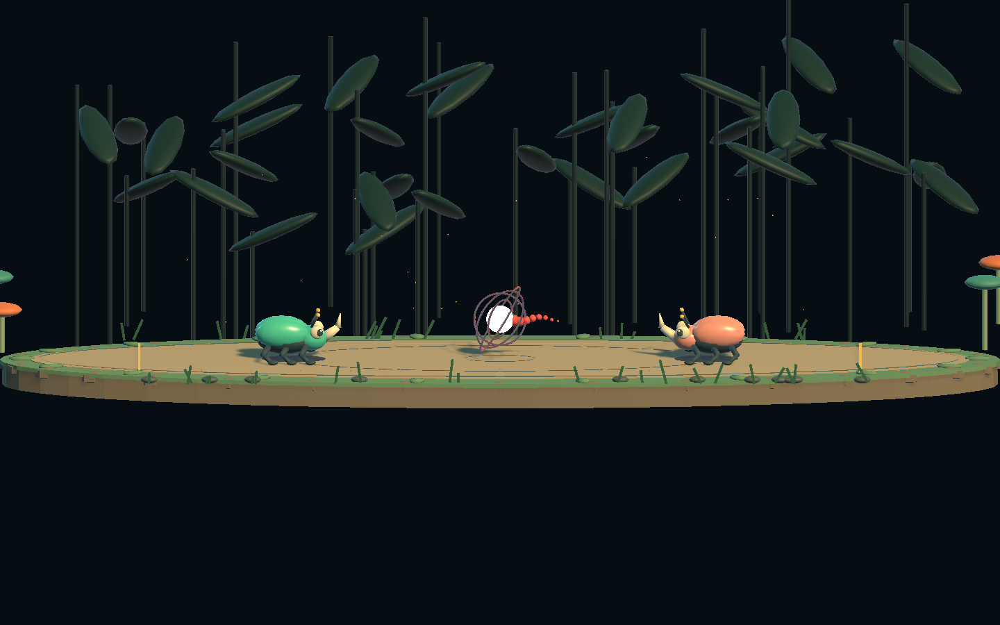
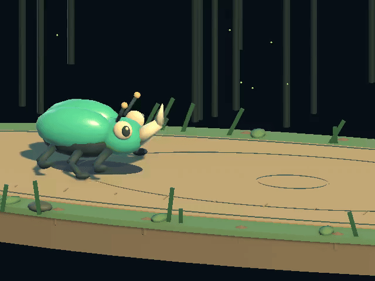

# Bug Arena / 斗虫擂台

Unity 6000.4.9f1 · Universal Render Pipeline · Input System

## 超级充能与肉鸽闯关

九关随机挑战，每三关一场 Boss 战，过关后从三个随机升级中选一个。十种升级可以组合为充能、反弹、生存和末端爆发打法；失败或通关后重开，清空本轮升级。每关恢复生命，已解锁关卡可以在当前种子下单独练习。新开一轮会更换种子；同一种子对应固定敌人，战斗中不会根据玩家表现偷偷增加强度。

按住 **Q** 充能 1.15 秒，满蓄后松开发射元气弹，基础伤害 **24**，冷却 **10 秒**；场上同时只有一个球。手机使用独立 **SUPER** 按钮。

**只有面向球的冲撞末端接触才能反弹。** 冲撞前段、待机、蓄力、恢复或空中接触都会受伤，护盾和受击无敌也不能抵消元气弹。每次反弹交换攻击目标并让伤害翻倍：**24 → 48 → 96 → 192 → …**。伤害达到剩余生命就直接击败目标；Boss 也遵守这条规则。

球随反弹增强亮度、环绕光圈、脉冲和拖尾；致命时红白闪动，HUD 显示 **LETHAL**。伤害和反弹次数使用 `BigInteger`，不设置翻倍次数上限；特效强度独立限幅，结算时先与生命比较再安全扣血，避免大整数转浮点溢出。

上图为三次反弹后的元气弹视觉预览；同一球的伤害已达到 192。

竞技场美术横向加宽 45%，各关可移动半宽为 10.5–12 米，双方初始相距 12 米。镜头按窗口宽高比适配，留出球的飞行和反弹空间。

## 开始试玩

1. 用 Unity Hub 打开本项目。
2. 菜单 **Bug Arena → Open Arena Scene**（场景：`Assets/BugArena/Scenes/BugArena.unity`）。
3. 点击 Play，再按 Enter 或点击 **Enter the Ring** 开始。
4. 如果 Game 视图被裁切，将顶部 Scale 调到最小；双击 Game 标签可最大化。

| 操作 | 按键 |
| --- | --- |
| 左右移动 | A / D 或方向键 |
| 蓄力 | 按住空格 |
| 向对手冲刺 | 松开空格 |
| 暂停 / 继续 | Esc |
| 重开整轮挑战 | R |
| 超级充能 / 发射 | 按住 Q 蓄满，再松开 |
| 选择过关升级 | 1 / 2 / 3，或点击卡片 |

角色自动面向对手。失去应用焦点时自动暂停。

## 核心玩法

- 蓄力 0–1.45 秒，冲刺距离从 1.65 米增加到 6.8 米；达到上限后可以继续按住。
- 蓄力时的细线表示冲刺距离，金色区域表示能够触发末端命中的**对手中心位置范围**。
- 普通命中造成 10–16 点伤害；末端命中造成 23–34 点伤害并挑飞。
- 打中正在蓄力的对手会打断蓄力，并追加 4 点伤害。
- 双方冲刺相撞会弹开，不扣血。
- 空冲后有 0.43 秒破绽；短蓄力适合近身，长蓄力适合远距离。
- 玩家 100 点生命，对手生命随关卡变化；普通关限时 75 秒、Boss 关 150 秒；普通关超时按剩余生命比例判胜，平局视为挑战失败；Boss 关必须在时限内击败 Boss，不能通过磨掉一点血后拖时间获胜。胜利选择升级后进入下一关；失败、完成挑战或按 R 都重开本轮并清空升级。

## 实现与验证

- `ArenaCombat.cs`：独立战斗状态与固定步长模拟；距离、伤害和蓄力参数在此调整。
- `ArenaGame.cs`：Input System 输入、回合流程、顿帧、镜头震动与合成音效。
- `ArenaVisuals.cs`：运行时构建甲虫、林间擂台、预判线与命中特效。
- `ArenaHUD.cs`：生命、蓄力、操作提示、暂停与结算界面。
- `Editor/ArenaSetup.cs`：场景创建和 **Run Combat Checks** 战斗检查入口。

角色和擂台使用 Blender 制作的 Q 版 FBX 模型，运行时从 `Assets/Resources/BugArenaArt` 加载；植物、光效和场地标线仍由程序生成。不依赖付费素材。当前提供单人九关随机肉鸽挑战，支持键盘和横屏触摸操作；尚未加入联网、角色选择、长期养成。

`Assets`（含 `.meta`）、`Packages` 与 `ProjectSettings` 纳入 Git；Unity 缓存、日志、构建产物和 IDE 生成文件由 `.gitignore` 排除。

## Blender 美术

唯一可编辑主文件是 `ArtSource/BugArena.blend`，已打包调色板贴图。桌面 `BugArenaModels/SOURCE_LOCATION.txt` 记录主文件位置；历史源文件在该目录的 Archive 中保存。

- 甲虫每只 4,480 三角面、16 根骨骼、最多两根骨骼影响，一个蒙皮网格、一个材质。
- 竞技场 2,164 三角面、一个材质。石块与苔藓使用低面数几何，石块平面着色、苔藓保持柔和。
- 每个模型使用 8×1 调色板 PNG：RGB 存 sRGB 颜色，alpha 存光滑度；UV 固定在色块中心，点采样、无 mipmap。Unity 使用标准 URP/Lit，按对手配色缓存材质，不使用 MaterialPropertyBlock。其他引擎可复用 FBX/UV/贴图，并按需接入 alpha 的光滑度。
- 植物按材质合并为七组静态网格，关闭装饰物投影；远景球体和圆柱使用低精度共享网格，花粉使用八面体。
- `Tools/rebuild_art.py` 一键生成几何、绑定动画并执行 Blender 验证（使用本机 Blender 路径）。此命令重建主文件，会覆盖手动编辑。
- 手动修改主文件后，用 Blender 后台运行 `Tools/export_current_art.py` 导出当前内容，不重新生成模型。FBX 和调色板同时输出到 Unity 资源目录与桌面的 `BugArenaModels/Exports`。
- `Tools/preview_blender_art.py` 和 `Tools/render_beetle_animation.py` 只渲染预览，不保存或改变主文件。
- 详细对比与验证结果见 `Docs/art-optimization.md` 和 `Docs/art-optimization.json`。当前尚未测试手机真机帧率。

## 随机关卡与手机操作

每轮 9 关，第 **3 / 6 / 9** 关为 Boss。普通敌人基础血量为 `80 + 关卡索引 × 35`；三个 Boss 的基础血量为 **600 / 1,000 / 1,600**，再随机浮动 ±15%。约 22% 的普通遭遇生成低血量对手，适合强构筑快速击败。

敌人随机选择近战、远程或反弹倾向，并携带实际生效的技能：末端增伤、快速充能、首击护盾、末端吸血。普通敌人一个技能，Boss 两个不同技能。血量高的随机结果会占用攻击强度预算，且不生成护盾加吸血组合；玩家的双技能联动奖励不应用于敌人。

每过关，基础冲撞伤害额外增加初始值的 25%，第九关达到 3 倍。Boss 半血强化仍有蓄力提示与恢复破绽，不锁血、不回血，元气弹反弹规则对双方相同。

**随机保底与选择代价：**

- 没有输出升级时，三选一至少提供一个输出选项。
- 已有半套流派时，至少提供一个可补齐的联动组件；仍可放弃它选择其他升级。
- 选择升级前可看到下一关类型、血量和技能，避免完全盲选。
- 连续失败两轮后，新一轮援助 1 级：敌人生命 -10%、冲撞强度 -8%、进攻间隔和大招蓄力延长。三轮失败后最多援助 2 级，分别 -20% / -16%；不是按血条输赢动态修改对手。
- 援助等级与种子显示在暂停界面；完整通关后清除失败连计。当前失败连计只在本次游戏运行期间保留，重新启动清零。
- 保底提供可用选项和受限敌人组合，不保证获胜。错过联动、选了不适合对手的升级或操作失误仍可能失败。

每关开场两秒准备。普通关 75 秒，Boss 150 秒且必须实际击败。胜利后 Enter，再用 1 / 2 / 3 或点击卡片选择升级。解锁记录保存在本机 PlayerPrefs；完整一轮包含八次升级选择。

### 本轮进化

| 升级 | 效果 / 组合方向 |
| --- | --- |
| Quick Core | 大招蓄力快 25%，冷却短 20% |
| Precision Horn | 末端区域延长 0.35 米，提升末端命中与反弹容错 |
| Fleet Feet | 移动速度 +20%，更容易调整距离 |
| Second Wind | 每次反弹恢复 12 生命 |
| Carapace Ward | 每关抵挡第一次冲撞伤害，不抵挡元气弹 |
| Iron Shell | 最大生命 +35 |
| Thunder Horn | 冲撞末端伤害 +40% |
| Hunter Instinct | 造成伤害的冲撞末端命中恢复 8 生命 |
| Feedback Loop | 每次反弹减少大招剩余冷却 3 秒 |
| Unstable Core | 发射的元气弹基础伤害变为 32，被顶回来时也更危险 |

升级不重复提供，效果在本轮后续关卡持续生效。完成组合会获得额外奖励，HUD 会显示已激活的联动：

- **RAMPAGE**：Thunder Horn + Hunter Instinct，末端伤害变为 2.1 倍，每次有效末端命中回血 12。
- **NOVA**：Quick Core + Unstable Core，元气弹基础伤害 64、冷却 5.6 秒；被反弹回来同样危险。
- **REBIRTH**：Precision Horn + Second Wind，每次成功反弹回血 20。

当前是单敌人对决，“割草感”体现为联动成型后快速打穿普通遭遇，还没有多敌人波次模式。

手机横屏左下左右按钮移动，右下 CHARGE 按住蓄力、松开冲刺，SUPER 蓄满松开发射，支持多指。蓄力时仍遵循原玩法锁定移动；可以同时保持移动手指，冲刺恢复后继续移动。顶部暂停，结算页面可直接触摸。界面根据屏幕安全区缩放；取消触摸和切后台会释放输入并暂停。

编辑器菜单 **Bug Arena → Preview Touch Controls** 启动触屏界面预览，鼠标可操作单个按钮，多指通过合成触摸测试验证。**Run Random Run Checks** 检查 100 个种子的敌人预算、Boss 节点、八次奖励和保底；**Run Super Checks** 检查末端反弹、错误接触受伤、连续翻倍、大整数安全和 Boss 破绽；**Render Super Preview** 输出不同反弹阶段的视觉预览。**Run Campaign Checks** 检查关卡、进化与结算，**Run Touch Checks** 检查双指与释放逻辑。预览图写入 `Library/BugArena/mobile-gameplay.png`。

当前安装的 Unity 只有 Mac 构建模块。Android/iOS 打包需先通过 Unity Hub 安装对应模块；本次没有进行手机真机构建和性能测试。

## Blender 骨骼动画

主文件时间轴：1–25 帧走路，40–112 帧待机，30 fps；NLA 中 Walk / Idle 独立导出。

六足采用两组三足交替步态。腿部直接挂在 Root 下，身体呼吸和起伏不带动支撑脚；逐帧根据变形后的脚底校正 IK，保留少量间隙避免采样误差穿地。待机包含身体呼吸和触角摆动。

动画只删除等于默认姿态的恒定通道；非默认的恒定姿态保留首尾键，其他曲线按误差简化。FBX 使用 60 Hz 烘焙及轻量曲线简化，Unity 开启关键帧缩减和恒定缩放曲线清理。Walk 0.8 秒、Idle 2.4 秒，均循环、不使用根运动。`BeetleAnimationPlayer` 按实际位移采样并混合，后退反向播放，暂停与顿帧冻结。每周期覆盖 1.20 米，抬脚高度 0.25 米；身体起伏加强，过渡时补偿关节混合造成的脚底下陷。起步在 0.04 秒内切入走路；步态按实际位移推进，30/60/120 fps 下相同移动距离得到相同步态。战斗模拟为 120Hz；动画跨两次模拟步保留移动状态，避免高渲染帧率下把零位移帧误判为待机。冲刺和受击击退保留滑行表现，不播放普通走路。

Unity 菜单 **Bug Arena → Run Art Optimization Checks / Run Animation Checks** 检查材质、接地、网格变形和状态切换；**Render Animation Preview** 以固定镜头、60fps 从实际视觉代码输出前进和后退预览帧到桌面 `BugArenaModels/Previews/UnityFrames`。

命令行可在关闭项目后用 `-executeMethod ArtOptimizationChecks.ValidateAll` 执行全部检查与渲染；已有编辑器打开时应使用菜单，或在临时工程副本中运行，避免并发打开同一工程。

随机预算、联动与验证边界见 [战斗设计说明](Docs/combat-design.md)。
