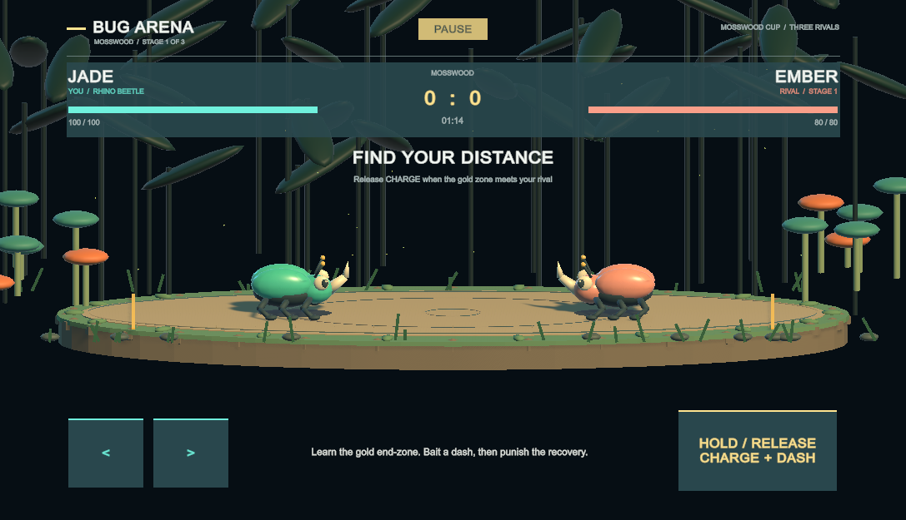

# Bug Arena / 斗虫擂台

Unity 6000.4.9f1 · Universal Render Pipeline · Input System

## 开始试玩

1. 用 Unity Hub 打开本项目。
2. 菜单 **Bug Arena → Open Arena Scene**（场景：`Assets/BugArena/Scenes/BugArena.unity`）。
3. 点击 Play，再按 Enter 或点击 **Enter the Ring** 开始。
4. 如果 Game 视图被裁切，将顶部 Scale 调到最小；双击 Game 标签可最大化。

| 操作 | 按键 |
| --- | --- |
| 左右移动 | A / D 或方向键 |
| 蓄力 | 按住空格 |
| 向对手冲刺 | 松开空格 |
| 暂停 / 继续 | Esc |
| 重开本局 | R |

角色自动面向对手。失去应用焦点时自动暂停。

## 核心玩法

- 蓄力 0–1.45 秒，冲刺距离从 1.65 米增加到 6.8 米；达到上限后可以继续按住。
- 蓄力时的细线表示冲刺距离，金色区域表示能够触发末端命中的**对手中心位置范围**。
- 普通命中造成 10–16 点伤害；末端命中造成 23–34 点伤害并挑飞。
- 打中正在蓄力的对手会打断蓄力，并追加 4 点伤害。
- 双方冲刺相撞会弹开，不扣血。
- 空冲后有 0.43 秒破绽；短蓄力适合近身，长蓄力适合远距离。
- 玩家 100 点生命，对手生命随关卡变化；每场限时 75 秒；超时按剩余生命比例判胜，平局视为挑战失败。胜利进入下一关，失败重试当前关；R 重试当前关。

## 实现与验证

- `ArenaCombat.cs`：独立战斗状态与固定步长模拟；距离、伤害和蓄力参数在此调整。
- `ArenaGame.cs`：Input System 输入、回合流程、顿帧、镜头震动与合成音效。
- `ArenaVisuals.cs`：运行时构建甲虫、林间擂台、预判线与命中特效。
- `ArenaHUD.cs`：生命、蓄力、操作提示、暂停与结算界面。
- `Editor/ArenaSetup.cs`：场景创建和 **Run Combat Checks** 战斗检查入口。

角色和擂台使用 Blender 制作的 Q 版 FBX 模型，运行时从 `Assets/Resources/BugArenaArt` 加载；植物、光效和场地标线仍由程序生成。不依赖付费素材。当前提供单人三关挑战，支持键盘和横屏触摸操作；尚未加入联网、角色选择、长期养成。

`Assets`（含 `.meta`）、`Packages` 与 `ProjectSettings` 纳入 Git；Unity 缓存、日志、构建产物和 IDE 生成文件由 `.gitignore` 排除。

## Blender 美术

唯一可编辑主文件是 `ArtSource/BugArena.blend`，已打包调色板贴图。桌面 `BugArenaModels/SOURCE_LOCATION.txt` 记录主文件位置；历史源文件在该目录的 Archive 中保存。

- 甲虫每只 4,480 三角面、16 根骨骼、最多两根骨骼影响，一个蒙皮网格、一个材质。
- 竞技场 2,164 三角面、一个材质。石块与苔藓使用低面数几何，石块平面着色、苔藓保持柔和。
- 每个模型使用 8×1 调色板 PNG：RGB 存 sRGB 颜色，alpha 存光滑度；UV 固定在色块中心，点采样、无 mipmap。Unity 使用标准 URP/Lit，按对手配色缓存材质，不使用 MaterialPropertyBlock。其他引擎可复用 FBX/UV/贴图，并按需接入 alpha 的光滑度。
- 植物按材质合并为七组静态网格，关闭装饰物投影；远景球体和圆柱使用低精度共享网格，花粉使用八面体。
- `Tools/rebuild_art.py` 一键生成几何、绑定动画并执行 Blender 验证（使用本机 Blender 路径）。此命令重建主文件，会覆盖手动编辑。
- 手动修改主文件后，用 Blender 后台运行 `Tools/export_current_art.py` 导出当前内容，不重新生成模型。FBX 和调色板同时输出到 Unity 资源目录与桌面的 `BugArenaModels/Exports`。
- `Tools/preview_blender_art.py` 和 `Tools/render_beetle_animation.py` 只渲染预览，不保存或改变主文件。
- 详细对比与验证结果见 `Docs/art-optimization.md` 和 `Docs/art-optimization.json`。当前尚未测试手机真机帧率。

## 三关挑战与手机操作

| 关卡 | 对手 | 变化 |
| --- | --- | --- |
| Mosswood | Ember | 80 生命、较慢进攻，练习末端命中 |
| Amber Grove | Cinder | 100 生命、偏好近身、更短进攻间隔 |
| Moonlit Crown | Onyx | 125 生命、瞄准更准，场地更窄 |

每关开场两秒准备。胜利后 Enter 或点击下一关；失败后重试；解锁记录保存在本机 PlayerPrefs。准备界面可以选择已解锁关卡。三关共用同一竞技场模型，通过边界宽度和对手配色区分。

手机横屏左下左右按钮移动，右下按住蓄力、松开冲刺，支持双指。蓄力时仍遵循原玩法锁定移动；可以同时保持移动手指，冲刺恢复后继续移动。顶部暂停，结算页面可直接触摸。界面根据屏幕安全区缩放；取消触摸和切后台会释放输入并暂停。

编辑器菜单 **Bug Arena → Preview Touch Controls** 启动触屏界面预览，鼠标可操作单个按钮，多指通过合成触摸测试验证。**Run Campaign Checks** 检查关卡与结算，**Run Touch Checks** 检查双指与释放逻辑。预览图写入 `Library/BugArena/mobile-gameplay.png`。

当前安装的 Unity 只有 Mac 构建模块。Android/iOS 打包需先通过 Unity Hub 安装对应模块；本次没有进行手机真机构建和性能测试。

## Blender 骨骼动画

主文件时间轴：1–25 帧走路，40–112 帧待机，30 fps；NLA 中 Walk / Idle 独立导出。

六足采用两组三足交替步态。腿部直接挂在 Root 下，身体呼吸和起伏不带动支撑脚；逐帧根据变形后的脚底校正 IK，保留少量间隙避免采样误差穿地。待机包含身体呼吸和触角摆动。

动画只删除等于默认姿态的恒定通道；非默认的恒定姿态保留首尾键，其他曲线按误差简化。FBX 使用 60 Hz 烘焙及轻量曲线简化，Unity 开启关键帧缩减和恒定缩放曲线清理。Walk 0.8 秒、Idle 2.4 秒，均循环、不使用根运动。`BeetleAnimationPlayer` 按实际位移采样并混合，后退反向播放，暂停与顿帧冻结。每周期覆盖 1.20 米，抬脚高度 0.25 米；身体起伏加强，过渡时补偿关节混合造成的脚底下陷。起步在 0.04 秒内切入走路；步态按实际位移推进，30/60/120 fps 下相同移动距离得到相同步态。战斗模拟为 120Hz；动画跨两次模拟步保留移动状态，避免高渲染帧率下把零位移帧误判为待机。冲刺和受击击退保留滑行表现，不播放普通走路。

Unity 菜单 **Bug Arena → Run Art Optimization Checks / Run Animation Checks** 检查材质、接地、网格变形和状态切换；**Render Animation Preview** 以固定镜头、60fps 从实际视觉代码输出前进和后退预览帧到桌面 `BugArenaModels/Previews/UnityFrames`。

命令行可在关闭项目后用 `-executeMethod ArtOptimizationChecks.ValidateAll` 执行全部检查与渲染；已有编辑器打开时应使用菜单，或在临时工程副本中运行，避免并发打开同一工程。
